 

[**LinkedIn**](https://www.linkedin.com/in/vedant-patil-933190330/) &nbsp;·&nbsp; [**Instagram**](https://instagram.com/vedantonmic) &nbsp;·&nbsp; [**Email**](mailto:vedbhumi123@gmail.com) &nbsp;·&nbsp; [**GitHub**](https://github.com/Vedant180205)

 

 

I build engineering systems that work across the full spectrum — **IoT, machine learning, backend, and data-driven applications.** Not demos. Systems. Things that actually run end-to-end.

My work doesn't live in one layer. It spans hardware and software, sensor input and model output, raw data and production-ready endpoints. That's not accidental — that's how I think.

Currently going deep on **data structures & algorithms**, **embedded systems**, and **low-level programming** — exploring system-oriented engineering at the intersection of ML, quant finance, and IoT. The domains where correctness isn't optional.

**Seeking internships in** &nbsp; <kbd>ML</kbd> &nbsp; <kbd>Quant Finance</kbd> &nbsp; <kbd>Systems Engineering</kbd> &nbsp; <kbd>Web Development</kbd>

> *Correctness before optimization. Explicit assumptions, always.*

 

